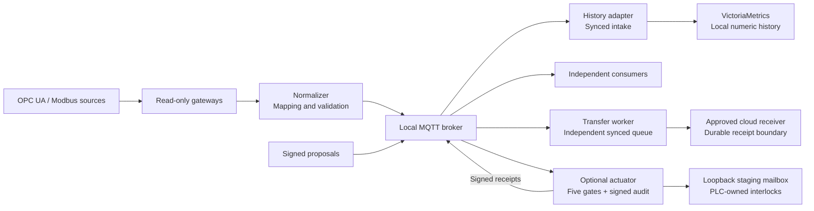

# OpenUMP — Hades

**Industrial data at the edge. Local visibility through cloud outages.**

[](https://github.com/openump/Hades/actions/workflows/contracts.yml)
[](go.mod)
[](LICENSE)

Hades is the industrial edge stack of **OpenUMP — Open Unified Machine Protocol**.
It connects machine observations to validated MQTT streams, local numeric history
and independent cloud delivery. A separate guarded control plane handles signed
actuation proposals.

[Quick start](#quick-start) · [Architecture](docs/architecture-design-specification.md) · [White paper](WHITEPAPER.md) · [Contribute](CONTRIBUTING.md)

## What Hades delivers

- **Connect machines:** read-only OPC UA software pilot and Modbus TCP acquisition.
- **Keep observations contextualized:** versioned contracts, asset identity, source timestamps and explicit quality.
- **Maintain local visibility:** MQTT fan-out and numeric history operate independently of cloud delivery.
- **Make delivery accountable:** bounded segmented WAL queues, backpressure, immutable retries and verified receiver receipts.
- **Guard control proposals:** signed commands, five deterministic gates and local operator controls, with L0 shadow as the default.

## Architecture at a glance



The acquisition plane remains read-only. Actuation is isolated and currently
restricted to a **single loopback mailbox per service**. Deployed Zeus processing
and physical PLC qualification are separate from the software pilot.

See the [technical architecture](docs/architecture-design-specification.md) for
component responsibilities, supervision, trust boundaries and execution flow.

## Quick start

Try synthetic telemetry and a validating consumer on your own machine.
**Prerequisites:** Git, Go 1.27.3 and Docker with Compose. A Go installation with
toolchain management can obtain the version pinned in [go.mod](go.mod).

```sh
git clone https://github.com/openump/Hades.git
cd Hades
docker compose -f deploy/compose.yaml up --build -d --wait
```

Start the consumer in this terminal:

```sh
go run ./cmd/hades-consumer -count 3
```

After its JSON `ready` message, open a second terminal in `Hades` and publish:

```sh
go run ./cmd/hades-simulator -scenario cycle -count 3
```

The consumer prints three validated telemetry records covering good quality,
bad quality and a missing/null reading. It preserves quality rather than turning
missing readings into zero. This example exercises MQTT and contract validation;
it does not connect a PLC or start history/cloud delivery.

Stop the development containers when finished; named volumes are retained:

```sh
docker compose -f deploy/compose.yaml down
```

This localhost development broker uses shared anonymous permissions. For service
identities and the secured stack, follow [identity and networking](docs/operations/identity-networking.md).
For normalization, history and independent consumers together, use the
[full local slice tutorial](docs/tutorials/local-slice.md).

## Current support

| Area | Available today | Qualification boundary |
|---|---|---|
| Acquisition | OPC UA mock pilot, persistent Telegraf Modbus TCP acquisition, PLC4Go Modbus read connector | Additional protocols and physical controllers need separate verification. |
| Local data | Validated MQTT distribution, approved asset catalog, synced history intake and numeric queries | Site retention, storage endurance and sustained capacity must be measured on the intended host. |
| Cloud delivery | Independent transfer queue, exact-byte retry and durable-receipt interface | Receiver fixtures do not establish deployed Zeus acceptance. |
| Actuation | Signed proposals, gates, audit/replay protection, local confirmation/kill and signed receipts | Loopback uint16 Modbus staging pilot only; no production PLC or fleet control qualification. |
| Operations | Reviewed supervision, live status, rollout/rollback and cold recovery tooling | Physical plant commissioning and production PKI remain site-specific. |

The Software Pilot MVP baseline is recorded in the [evaluation package](docs/releases/mvp-evaluation.md).
Acceptance guarantees are explicit: MQTT PUBACK, historian API acceptance and a
verified durable receiver receipt are different boundaries. See
[delivery semantics](docs/protocol/delivery.md).

## Explore the documentation

| Start here | Guides |
|---|---|
| **Evaluate Hades** | [White paper](WHITEPAPER.md) · [Architecture](docs/architecture-design-specification.md) · [MVP evaluation](docs/releases/mvp-evaluation.md) |
| **Run a local stack** | [MQTT development](docs/tutorials/mqtt-development.md) · [Synthetic telemetry](docs/tutorials/simulated-telemetry.md) · [Full local slice](docs/tutorials/local-slice.md) |
| **Understand the contracts** | [Namespace and identity](docs/protocol/namespace.md) · [Telemetry](docs/protocol/telemetry.md) · [Metadata/status](docs/protocol/metadata-status.md) · [Write control](docs/contracts/write-control-plane.md) |
| **Operate and secure** | [Runbook](docs/operations/runbook.md) · [Identity/networking](docs/operations/identity-networking.md) · [Actuator](docs/operations/actuator.md) · [Backup/restore](docs/operations/backup-restore.md) |
| **Measure and verify** | [Capacity report](docs/operations/capacity-report.md) · [Retention sizing](docs/operations/retention-sizing.md) · [Recovery evidence](docs/operations/recovery-evidence.md) · [Conformance](docs/protocol/conformance.md) |
| **Inspect implementation choices** | [Dependency inventory](docs/dependencies.md) · [Go runtime decision](docs/decisions/0003-runtime-language.md) · [Durability decision](docs/decisions/0004-delivery-durability.md) |

## Development and contributions

Custom deployed services and operational CLIs use **Go**. Python supports optional
development tests and independent reference consumers; the custom production
services and OPC UA mock implementation are Go.

```sh
./scripts/check-contracts
go test -race ./...
go vet ./...
```

The conformance check covers nine versioned contracts and 132 shared fixtures.
For the optional Python development reference (Python 3.11+):

```sh
python3 -m venv .venv
.venv/bin/python -m pip install -r requirements-dev.txt
.venv/bin/python -m unittest discover -s tests -v
```

Read [CONTRIBUTING.md](CONTRIBUTING.md) before submitting changes. Track work in
[Hermes](https://github.com/openump/Hermes), referencing stable `Hades-NNN` ticket
IDs in implementation PRs. Keep credentials, private keys, site exports and
runtime data outside Git.

## OpenUMP ecosystem

| Repository | Role |
|---|---|
| **[Hades](https://github.com/openump/Hades)** | Industrial edge acquisition, local data services and guarded control. |
| **[Zeus](https://github.com/openump/Zeus)** | Cloud ingestion, analytics and AI architecture. |

## License

[Apache License 2.0](LICENSE). See the [license policy](docs/decisions/0001-license-policy.md)
and [dependency notices](docs/dependencies.md) for third-party requirements.
