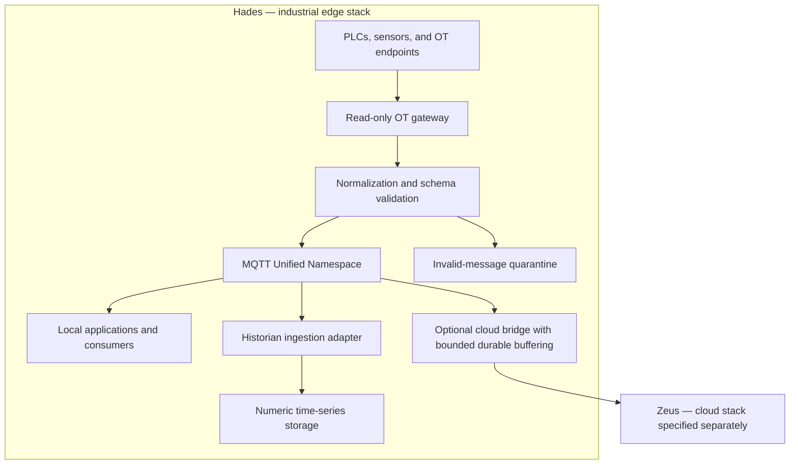

# OpenUMP — Hades

## White Paper: Industrial Connectivity Architecture and Deployment Specification

**Status:** Initial proposal, version 0.2  
**Date:** 13 October 2026  
**Project:** OpenUMP (Open Unified Machine Protocol)  
**Repository:** [openump/Hades](https://github.com/openump/Hades)  
**Domain:** Open-source industrial connectivity and edge data infrastructure  
**Deployment model:** Edge-first, with optional cloud integration  
**Purpose:** Establish the technical foundation for building Hades, the industrial stack within OpenUMP

---

## 1. Executive Summary

Industrial systems often connect machines, applications, and analytical services through independently maintained interfaces. Each integration introduces its own naming conventions, data formats, and operational dependencies. As the number of consumers grows, these point-to-point connections become difficult to understand, change, and operate.

OpenUMP proposes a common contract for publishing machine data into a Unified Namespace (UNS). It combines consistent asset identification, versioned message schemas, explicit measurement semantics, and a lightweight reference deployment. Producers publish contextualized observations once; authorized consumers subscribe to the data they need.

OpenUMP is an application-level protocol proposal built on existing transports. It does not replace MQTT, OPC UA, Modbus, or machine control protocols. Its contribution is the shared meaning and behavior of messages exchanged between industrial gateways, storage adapters, applications, and future AI tools.

Hades is the open-source industrial connectivity stack that implements this foundation. Its reference architecture separates acquisition, normalization, messaging, persistence, and the edge-side cloud transfer interface. A single-site deployment should run in containers without requiring Kubernetes. Component selection remains replaceable: interoperability should depend on the OpenUMP contract rather than a particular broker or database.

The project targets a small operational footprint, reproducible deployment, and useful machine context. Memory savings, throughput, latency, retention capacity, and storage endurance must be measured on representative hardware before publishing numerical claims.

### 1.1 OpenUMP repository organization

OpenUMP is organized into three repositories with distinct responsibilities:

| Repository | Responsibility |
| --- | --- |
| [Hades](https://github.com/openump/Hades) | The open-source industrial stack: machine connectivity, normalization, Unified Namespace, local history, edge deployment, and outbound data transfer. This white paper specifies Hades. |
| [Zeus](https://github.com/openump/Zeus) | The cloud stack that receives data from Hades and provides cloud analytics and AI capabilities, following the architectural contracts established by Hades. |

The companion [Zeus white paper](https://github.com/openump/Zeus/blob/main/WHITEPAPER.md) describes the cloud stack in a separate document. Cloud service selection, cloud storage architecture, analytics pipelines, and AI orchestration are outside this Hades white paper. Hades defines the edge responsibilities and data interface needed for that future integration.

## 2. Problem and Design Objectives

### 2.1 The integration problem

A broker alone does not establish a shared industrial data model. A temperature value is ambiguous without an asset identity, timestamp, unit, quality indicator, and measurement definition. Consumers also need to distinguish a current observation from an old retained value or a replayed event.

Edge sites introduce additional constraints: limited resources, intermittent connectivity, restricted access to operational technology (OT), and maintenance windows that differ from cloud operations. A useful architecture must continue collecting locally when cloud services are unavailable.

### 2.2 Objectives

OpenUMP aims to:

- Define a consistent, versioned contract for machine observations and asset metadata.
- Support a hierarchical namespace inspired by ISA-95 equipment organization.
- Separate protocol drivers from transformations and downstream consumers.
- Enable local collection and consumption without a cloud dependency.
- Keep mappings and deployment configuration reviewable in version control.
- Provide explicit failure, buffering, and recovery behavior.
- Expose trustworthy data to analytics and AI applications through controlled interfaces.
- Preserve an open-source reference deployment through deliberate dependency and license selection.

### 2.3 Initial scope

The first Hades release should support one site, simulated telemetry, one real OT integration, schema validation, MQTT publication, numeric history, and a sample consumer. Asset metadata and operational health are part of the foundation.

Machine actuation, safety control, multi-site high availability, knowledge graphs, vector search, and autonomous agents are later extensions. OpenUMP is not a hard real-time or safety-certified control system. Initial OT connections are read-only.

## 3. Protocol and Data Contract

The following contract is proposed for the MVP. It must become a machine-readable schema and a conformance test suite before it is treated as a stable specification.

### 3.1 Namespace

A proposed topic structure is:

```text
openump/v1/{enterprise}/{site}/{area}/{line}/{asset}/{message_type}
```

For example:

```text
openump/v1/acme/berlin/assembly/line-01/press-04/telemetry
openump/v1/acme/berlin/assembly/line-01/press-04/metadata
openump/v1/acme/berlin/assembly/line-01/press-04/status
```

The hierarchy is an OpenUMP convention inspired by ISA-95; it is not a claim of ISA-95 conformance. Sites must define how their actual equipment maps to these levels. Assets that do not fit a production line need a documented mapping rather than fabricated relationships.

Identifiers must be stable and distinct from editable display names. Each topic segment must exclude `/`, MQTT wildcards `+` and `#`, and empty values. Identifier encoding, length limits, and asset relocation rules must be resolved in the formal specification.

### 3.2 Telemetry envelope

A proposed observation looks like this:

```json
{
  "schema_version": "1.0",
  "message_id": "019a1234-5678-7000-8000-000000000001",
  "asset_id": "urn:openump:acme:berlin:press-04",
  "observed_at": "2026-10-13T14:00:00.000Z",
  "ingested_at": "2026-10-13T14:00:00.120Z",
  "source": {
    "gateway_id": "gateway-01",
    "protocol": "modbus",
    "sequence": 1042
  },
  "measurements": {
    "hydraulic_pressure": {
      "value": 182.4,
      "unit": "bar",
      "quality": "good"
    },
    "motor_temperature": {
      "value": 67.2,
      "unit": "Cel",
      "quality": "good"
    }
  }
}
```

Proposed requirements:

- `schema_version` identifies the payload contract; the topic version identifies its major compatibility family.
- `message_id` identifies an observation and remains unchanged during retries and replay.
- `asset_id` references the asset metadata record and agrees with the configured topic mapping.
- `observed_at` records acquisition or device time in UTC. Metadata must identify its clock origin and known uncertainty.
- `ingested_at` records arrival at the normalization boundary, not broker acknowledgement or historian persistence.
- `source` preserves gateway identity and acquisition provenance. Sequence scope and reset behavior must be documented per producer.
- Measurement definitions specify types, units, valid ranges, and interpretation. Unit strings should follow a documented convention, such as UCUM.
- Quality is explicitly `good`, `uncertain`, or `bad`. Missing or invalid readings must not become fabricated zero values.

The formal schema must define null handling, non-numeric values, maximum payload size, timestamp validation, and unknown-field behavior. JSON cannot represent non-finite numbers; adapters must map those conditions to explicit invalid readings.

### 3.3 Metadata and status

Metadata describes asset identity, display name, equipment type, hierarchy, measurement definitions, and a metadata revision. Relationships such as “pump supplies press” belong in metadata or an optional semantic model; a topic path alone cannot express them.

Status messages describe producer availability and acquisition health. Consumers must assess freshness from timestamps and expected update intervals. Broker connectivity alone does not prove a machine is operating or its data is valid.

Metadata and latest status may use retained MQTT messages. Telemetry is not retained by default. Any future retained latest-value profile must define expiry and freshness behavior.

### 3.4 Delivery and compatibility

The initial profile should use MQTT QoS 1 where supported and appropriate, with duplicate-tolerant consumers. QoS 1 does not provide exactly-once storage or end-to-end durability. Applications must define acknowledgement boundaries and deduplication behavior using message IDs.

Breaking contract changes require a new major version and a migration period. Compatible additions still require documented consumer behavior. Schema validation failures go to a bounded quarantine path with diagnostic information, not the normal telemetry namespace.

## 4. Hades Reference Architecture



The minimum runtime contains one MQTT broker. Additional streaming infrastructure is optional and belongs where justified by consumer requirements. Kubernetes may be used centrally or at larger sites, but it is not a prerequisite for the single-site reference deployment.

### 4.1 Acquisition

A gateway reads explicitly configured registers, tags, or nodes and emits observations. Poll intervals, timeouts, reconnect behavior, scaling, and device load limits must be configurable.

Telegraf and Apache PLC4X are candidate technologies, not interchangeable universal drivers. The implementation must verify support for each device, protocol, and selected release. Apache PLC4X may require a JVM-based adapter, so the architecture does not assume that all services are native Go or Erlang binaries.

Local HTTP carrying JSON is one possible gateway-to-normalizer interface. Its schema, authentication boundary, backpressure, and acknowledgement behavior must be defined. It must not acknowledge durable acceptance unless the observation has reached the declared durable boundary.

### 4.2 Normalization

Bento is a candidate stream-processing engine for declarative mappings. It can provide a configurable transformation layer; the exact plugins and schema-validation mechanism must be verified during implementation. Its upstream repository provides the source and license information: [Bento](https://github.com/warpstreamlabs/bento).

Mappings resolve raw signals into stable measurement names, convert units, attach asset context, preserve quality and provenance, and validate the result. Transformations must avoid silently discarding source timestamps or diagnostic information needed for investigation.

### 4.3 MQTT namespace

The broker routes messages and enforces authentication and topic authorization. Producers and validators enforce OpenUMP payload semantics; a topic hierarchy alone does not enforce them.

EMQX was proposed in the original draft and remains a candidate. Starting with version 5.9, EMQX uses BSL 1.1, which its documentation describes as source-available. Consequently, an unrestricted claim that a current EMQX-based stack is entirely open source would be inaccurate. Broker selection must evaluate the chosen version, license, maintenance status, and required features. See [EMQX licensing documentation](https://docs.emqx.com/en/emqx/latest/get-started/deploy/license.html).

The core protocol must remain broker-independent. A maintained broker with a license compatible with the project's open-source goals should be selected before implementation. Broker-specific connectors are optional integrations.

### 4.4 Historian

VictoriaMetrics is a candidate for numeric measurement history. A subscriber or ingestion adapter must convert OpenUMP telemetry into a supported metric ingestion format; the architecture must not assume native storage of arbitrary MQTT JSON. See [VictoriaMetrics data ingestion](https://docs.victoriametrics.com/victoriametrics/data-ingestion/).

The adapter defines metric naming, unit mapping, timestamp handling, duplicate treatment, and quality representation. Labels must use bounded dimensions such as site and asset. Message IDs, unrestricted text, and per-event timestamps must not become labels.

A numeric historian does not replace storage for metadata, maintenance records, manuals, or arbitrary events. Those require separate persistence if introduced. Retention must be sized from measured sample rates, series cardinality, compression, disk capacity, and endurance. Long-term storage on inexpensive flash is not guaranteed.

### 4.5 Cloud bridge

The Hades bridge forwards approved topic subsets to a Zeus ingestion endpoint. The endpoint and receiving contract must be agreed before integration; the Zeus implementation will be specified in its separate white paper. It may use MQTT or an adapter for another transport. Broker-native cloud connectors must be checked against the selected release and license; they are not assumed to be universally available.

The bridge requires bounded disk buffering, retry backoff, replay identifiers, and a documented overflow policy. MQTT session persistence is not a substitute for a verified end-to-end store-and-forward design. Cloud outages must not block local telemetry processing within the deployment's documented resource limits.

## 5. Deployment and Operations

### 5.1 Single-site baseline

The first deployment should use Docker Compose on a supported Linux edge host. Podman support may be added after validating its runtime and Compose compatibility. Persistent data, configuration, and secrets must have separate lifecycles.

A proposed implementation layout is:

```text
Hades/
├── WHITEPAPER.md
├── schemas/
├── examples/
├── config/
│   ├── gateway/
│   ├── normalization/
│   └── broker/
├── deploy/
│   └── compose.yaml
└── tests/
    └── conformance/
```

Only this white paper is delivered at this stage. The deployment file and configuration directories above are planned artifacts, not an executable stack.

### 5.2 Deployment requirements

A reference deployment must include:

- Pinned, reviewed image versions and preferably immutable digests.
- Internal service networking and explicit host port exposure.
- Persistent volumes for broker state, buffering, and historian data where required.
- Health checks, retry behavior, and recovery after dependency restarts.
- Resource limits, bounded logs, and disk-capacity monitoring.
- Secrets supplied outside committed configuration.
- Backup and restore procedures verified against the selected components.
- A documented startup, upgrade, and rollback procedure.

Service startup order does not establish readiness. Every client must handle temporary dependency unavailability.

### 5.3 Configuration as code

Mappings, schemas, and deployment manifests should be reviewed and versioned in Git. Validation should check syntax, references, schema compatibility, and representative telemetry before rollout.

Version-controlled files alone do not provide GitOps reconciliation. The MVP can use a controlled deployment process; fleet-scale reconciliation requires a later deployment agent or controller. Each site should report the running configuration revision so operators can detect drift.

### 5.4 Reliability and observability

The runtime must expose acquisition errors, invalid-message counts, processing latency, publish failures, queue depth, dropped observations, disk usage, and cloud replay progress. Stale readings should be visible to consumers.

Operators must be able to distinguish device failure, gateway failure, broker failure, historian failure, and cloud-link failure. Recovery tests must cover restarts, interrupted writes, full queues, and full disks. Buffering limits and expected data loss must be documented rather than hidden behind an availability claim.

## 6. Security and Operational Boundaries

OT access should be read-only and limited to approved endpoints. Network segmentation must restrict traffic between OT devices, edge services, management interfaces, and cloud systems.

Each service receives a distinct identity and minimum necessary permissions. MQTT publishers may write only to their assigned topics; consumers may read only their authorized scope. Management APIs must be protected and exposed only where needed. Connections crossing trust boundaries require authenticated encryption and managed credentials.

Incoming data must be validated for size, type, and structure. Configuration changes require review and an audit trail. Payloads, logs, and metadata should avoid unnecessary sensitive information.

Any future command or writeback channel requires a separate contract, authorization policy, audit trail, expiry rules, and operational approval model. It must not inherit permissions from telemetry subscriptions.

## 7. Interface to Zeus

Hades supplies contextualized industrial data for Zeus to receive, analyze, and use in AI applications. The shared interface must preserve asset identity, schema version, observation timestamps, units, quality, and provenance across the edge-to-cloud boundary.

Hades owns outbound topic selection, edge credentials, local buffering, retries, replay identifiers, and transfer observability. The receiving acknowledgement boundary must be agreed with Zeus so that Hades can distinguish successful transfer from a connection that has merely accepted bytes.

Zeus owns cloud ingestion and downstream cloud processing. Its architecture, storage choices, analytics, semantic services, and AI tooling will be described in a separate Zeus white paper. This document does not select those services.

Hades must remain usable when Zeus is unavailable. Cloud integration must respect the local resource limits and failure behavior defined in this white paper. Any future commands or writeback from Zeus require the separate authorization and operational controls described in Section 6.

## 8. Implementation Roadmap

Implementation tickets, project plans, and issues for this roadmap are tracked in [Hermes](https://github.com/openump/Hermes). Hades implementation changes belong in [Hades](https://github.com/openump/Hades); Zeus implementation changes belong in [Zeus](https://github.com/openump/Zeus).

### Phase 1 — Formalize the contract

Define JSON schemas, topic rules, identity conventions, metadata, quality semantics, delivery behavior, and compatibility policy. Publish valid and invalid examples and record component-selection decisions with their licensing rationale.

### Phase 2 — Build the local vertical slice

Implement a simulator, normalization pipeline, MQTT broker deployment, historian adapter, and sample consumer. Demonstrate one observation moving through the entire pipeline with its identity, timestamp, unit, and quality preserved.

### Phase 3 — Integrate one real machine

Add one verified OT driver. Validate device load, scaling, clock behavior, signal definitions, and read-only permissions with the site operator.

### Phase 4 — Prove operation under failure

Test restart recovery, duplicate delivery, invalid input, local backpressure, disk limits, and temporary loss of cloud connectivity. Establish hardware requirements and measured operating limits.

### Phase 5 — Extend deliberately

Add the Hades-to-Zeus bridge, fleet configuration management, and additional industrial adapters based on validated use cases. Plan cloud analytics and AI work in Hermes against the separate Zeus white paper.

## 9. MVP Acceptance Criteria

The first Hades implementation is ready for evaluation when:

1. A clean host can start the documented reference stack from pinned artifacts.
2. A simulator and one supported OT source publish schema-valid observations.
3. Two independent consumers interpret the same asset, measurements, units, and timestamps consistently.
4. Invalid payloads are quarantined with actionable diagnostics and bounded storage.
5. Numeric telemetry reaches the historian through an explicit adapter and is queryable by asset and time range.
6. Tests demonstrate duplicate handling and recovery after service restarts.
7. Local acquisition continues during cloud unavailability within documented queue limits; overflow behavior is observable.
8. Authentication and topic authorization reject unauthorized publication and subscription.
9. Configuration can be validated, deployed, identified at runtime, and rolled back.
10. Published measurements describe resource use, latency, throughput, retention assumptions, and failure-related data loss on named hardware.

## 10. Decisions Required Before Implementation

The white paper establishes direction, while the following choices remain open:

- Project license and dependency license policy.
- Maintained MQTT broker and supported protocol profile.
- First OT protocol, device, driver, and edge hardware target.
- Formal schema details, unit convention, and stable asset identity rules.
- Durable acceptance boundary, buffer placement, capacity, and overflow policy.
- Historian mapping and retention requirements.
- Credential provisioning, rotation, and site deployment process.

These decisions should be recorded in architecture decision records as they are accepted. Component capabilities and licenses must be rechecked for the exact versions selected.

## 11. Closing Perspective

Hades establishes OpenUMP's industrial foundation: a clear data contract supported by a small, replaceable edge runtime. Its first milestone is a working, measurable path from machine observation to contextualized publication and local history. Hermes coordinates implementation work, while Zeus extends that foundation into cloud analytics and AI under a separate white paper.
