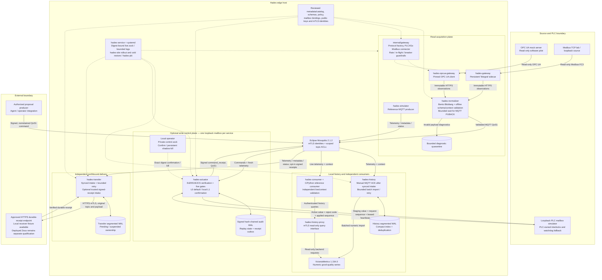
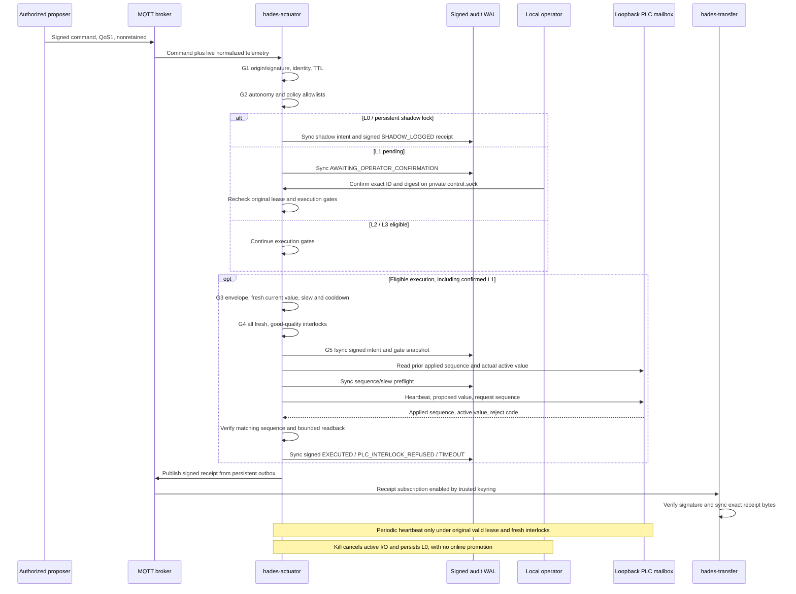

# OpenUMP — Hades technical architecture

**Updated:** 20 October 2026
**Implementation:** [openump/Hades](https://github.com/openump/Hades)
**Baseline:** main through [Hades PR #24](https://github.com/openump/Hades/pull/24),
including Hades-026–033 runtime changes. A merged implementation and passing
software-pilot checks do not establish physical-device or production qualification.

OpenUMP (Open Unified Machine Protocol) separates **Hades**, the industrial edge
stack, from **Zeus**, the cloud stack. Hades acquires observations, validates and
normalizes them, distributes them locally, maintains numeric history, and forwards
owned records through an independent cloud queue. An optional write-control
service mediates signed proposals through deterministic gates and PLC-owned
staging logic. Hermes holds implementation tickets and verification records.

## 1. Component diagram

Solid arrows show data or control messages. Dashed arrows show configuration,
supervision or local operator authority. The read acquisition plane remains
read-only; the actuator is a separate, explicitly enabled software-pilot plane.

`internal/gateway` is a library boundary, not an additional deployed daemon.
The PLC4Go connector currently implements Modbus TCP reads; the protocol factory
and guardrails do not imply delivered Siemens S7, EtherNet/IP, ADS, BACnet or
serial drivers. Those remain expansion work requiring separate verification.
The diagram's agent/Zeus boundaries are integration points, not deployed services
inside this Hades repository.

## 2. Runtime components and implementation paths

Custom services and operational tools use Go 1.27.3, pinned in [go.mod](../go.mod).
Selected upstream components and versions are recorded in
[dependencies](dependencies.md) and [ADR-0002](decisions/0002-reference-components.md).

| Component | Implementation | Responsibility |
|---|---|---|
| Acquisition | `cmd/hades-gateway`, `cmd/hades-opcua-gateway`, `internal/gateway` | Read-only acquisition, timestamp/quality provenance, protocol selection and device protection. |
| Normalizer | `cmd/hades-normalizer`, `internal/normalize` | Embedded mapping, strict validation, quarantine and bounded synchronous broker acceptance. |
| Broker | `deploy/broker`, `config/broker/security` | Local QoS1 fan-out, retained context, scoped service identities and ACL separation. |
| Historian adapter | `cmd/hades-history`, `internal/history` | Synced intake, deduplication, numeric mapping and bounded batch delivery. |
| Numeric store/query boundary | VictoriaMetrics, `cmd/hades-history-proxy`, `internal/historyproxy` | Numeric history with authenticated read-only query access. |
| Independent consumers | `cmd/hades-consumer`, `examples/consumer-secondary` | Validate live context and compare retained historical values without coupling to transfer. |
| Transfer | `cmd/hades-transfer`, `internal/transfer` | Independent ownership queue, exact-byte replay, durable receipt validation and explicit suspension. |
| Actuator | `cmd/hades-actuator`, `internal/actuator` | Signed proposal verification, gates, staging/readback, watchdog, local confirmation/kill and receipt outbox. |
| Shared contracts/context | `schemas/v1`, `internal/contracts`, `internal/sample`, `internal/catalog` | Offline schemas, approved asset/topic/revision context and service configuration. |
| Persistence | `internal/storage` | Bounded synced segmented WAL and compact in-memory index; no flat file-per-record runtime store. |
| Supervision and operations | `cmd/hades-service`, `internal/supervisor`, `cmd/hades-site`, `internal/site` | Reviewed artifact integrity, live status, lifecycle, rollout/rollback and isolated cold restore. |
| Provisioning and verification | `cmd/hades-pki`, `cmd/hades-check`, `cmd/hades-capacity` | Local identities, conformance and measured capacity workloads. |

## 3. Telemetry flow and ownership

1. Gateways acquire from approved sources and preserve original observation ID,
   timestamp, source/boot/sequence and quality. Retry ownership stays at the
   gateway until the normalizer returns explicit `202 accepted_broker_ack`.
2. The normalizer performs mapping and strict schema/context validation, then
   waits within a four-second queue/publication budget for MQTT QoS1 PUBACK.
   Failure, expiry or capacity pressure returns `503` and backpressure. Its
   bounded pending queue is volatile; it does not claim a synced ingress spool.
3. History and transfer subscribe independently. Each syncs intake before manual
   MQTT acknowledgement. History sends bounded numeric batches to VictoriaMetrics;
   transfer uses a separate drain/retry path so cloud outages do not block history.
4. Consumers use exact registry-resolved `/telemetry`, `/metadata` and `/status`
   topics. Telemetry is nonretained; contextual metadata/status support readiness.
   The topic profile has no extra `/telemetry/+` measurement level.
5. Transfer preserves original topic and payload bytes until a matching authenticated
   durable receiver receipt. Permanent failures remain suspended for diagnosis;
   transport/API acceptance never silently retires ownership.

| Boundary | Meaning | What it does not establish |
|---|---|---|
| Gateway pending reading | Immutable volatile retry copy | Survival of gateway process/power loss. |
| HTTP `202 accepted_broker_ack` | MQTT broker PUBACK obtained | Power-loss-safe broker persistence, synced subscriber intake or cloud durability. |
| History/transfer intake | Synced bounded local WAL ownership | Successful historian import or cloud acceptance. |
| Historian API acceptance | Import endpoint accepted a request | Independent proof of power-loss durability. |
| Verified receiver receipt | Transfer profile/topic/body/identity binding accepted at the configured durable boundary | Deployed Zeus analytics, AI processing or production qualification. |

See [ingress acceptance](operations/ingress-acknowledgement.md),
[delivery protocol](protocol/delivery.md), [history mapping](protocol/history-mapping.md),
[drain scheduling](operations/drain-scheduling.md), and
[Zeus transfer interface](integration/zeus-transfer.md).

## 4. Actuation component sequence

The acquisition and telemetry replay services never issue control writes.
`hades-actuator` is a separate opt-in service. Its implemented driver is restricted
to one literal-loopback Modbus mailbox per service, unit ID 1 and uint16
engineering values. L0 shadow is the startup default even when policy permits
higher autonomy. Direct physical-output and coil writes have no driver API.

An expired/retained command, failed precondition, unsafe value or untrusted origin
cannot authorize a staging write. Identical command retries do not execute again;
changed bodies under a consumed ID conflict. An unfinished synced intent becomes
`TIMEOUT` after restart and is never automatically replayed. A newer uncertain
write cannot inherit an older heartbeat lease.

The PLC owns acceptance interlocks, physical safety and watchdog fallback. Edge
shutdown or kill cannot recall a packet already in flight. Real ladder behavior,
register maps, encoding, controller timing and safety acceptance require a separate
physical-device pilot. Signed audit chains need an independently anchored head to
detect tail rollback. Audit capacity exhaustion fails closed rather than evicting
replay protection. See [actuator operations](operations/actuator.md) and
[write-control contracts](contracts/write-control-plane.md).

## 5. Trust, resource and operational boundaries

- Local reference service links use explicit mTLS identities and role/topic ACLs;
  TLS 1.3 is the minimum on every authenticated link (Go services, the
  transfer receiver client and the secure Mosquitto profile); TLS 1.2 peers are refused.
  Read and write-control permissions are separate. Signature keys are locally
  provisioned trust; they are never fetched from a command payload.
- Historian backends remain behind a read-only authenticated proxy. Cloud access
  is restricted to the independent transfer worker and approved receiver endpoint.
- Count/byte/disk-reserve bounds cover pending waits, WAL ownership, quarantine,
  request bodies and operational logs. Default normalizer pending limits are
  4,096 records / 16 MiB; history and transfer use configurable bounded WAL stores.
  The actuator audit is capped at 10,000 entries / 64 MiB with a filesystem reserve.
- `hades-service` binds process status to reviewed binary/config digests via
  `live.sock`; its integrity cache avoids rehashing unchanged payloads on every
  status request. Actuator `control.sock` is a separate mode-0600 local operator
  endpoint under a mode-0700 directory.
- Site rollout and cold restore preserve configuration and ownership boundaries.
  A backup archive or successful cross-build alone does not prove installed
  lifecycle, physical-device acceptance or recovery on a named production host.

Operational references: [identity/networking](operations/identity-networking.md),
[diagnostics](operations/diagnostics.md), [configuration rollout](operations/configuration-rollout.md),
[backup/restore](operations/backup-restore.md), [runbook](operations/runbook.md),
[capacity report](operations/capacity-report.md), and [retention sizing](operations/retention-sizing.md).

## 6. Implemented baseline and remaining evolution

| Area | Implemented baseline | Separate qualification or future work |
|---|---|---|
| Persistence and delivery | Segmented WAL, bounded batch drain, broker-ack ingress and isolated cloud retry | Production disk endurance, retention budgets and failure windows on named hosts. |
| Assets and acquisition | Approved multi-asset catalog, OPC UA mock pilot, persistent Telegraf and PLC4Go Modbus read connector | Physical Siemens S7-1200/other controllers, additional protocols and site access. |
| Contracts and actuation | Seven-schema profile, signed five-gate actuator, loopback staging/readback and signed receipt transfer | Production PLC transport/encoding, fleet-wide control, ladder/watchdog and operator qualification. |
| Cloud | Hades transfer interface and isolated receiver fixture | Deployed Zeus ingestion, semantics, analytics and agent integrations. |
| Operations | Reviewed supervision, rollout, cold recovery and reference capacity tooling | Hardware/site-specific commissioning and acceptance. |

The earlier ADS treated Hades-026–033 as future work. Their merged runtime
implementations now belong in the component baseline above. Broad protocol
coverage, physical deployments and autonomous factory operations remain targets;
they must not be inferred from a shared driver interface or a passing mock pilot.

Governing decisions: [license policy](decisions/0001-license-policy.md),
[reference components](decisions/0002-reference-components.md),
[Go runtime language](decisions/0003-runtime-language.md), and
[explicit delivery boundaries](decisions/0004-delivery-durability.md).
