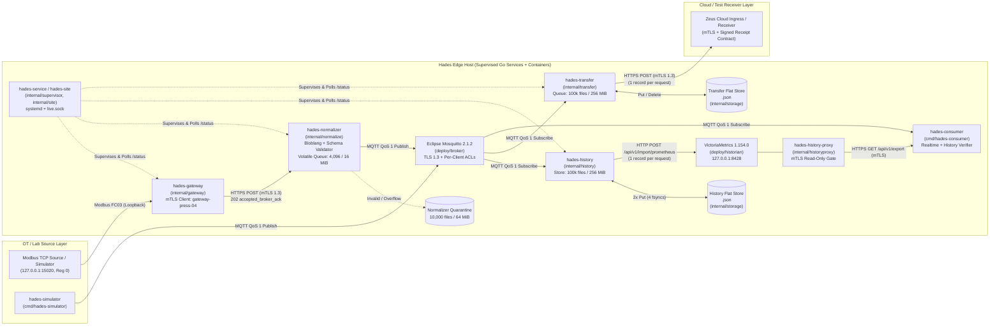
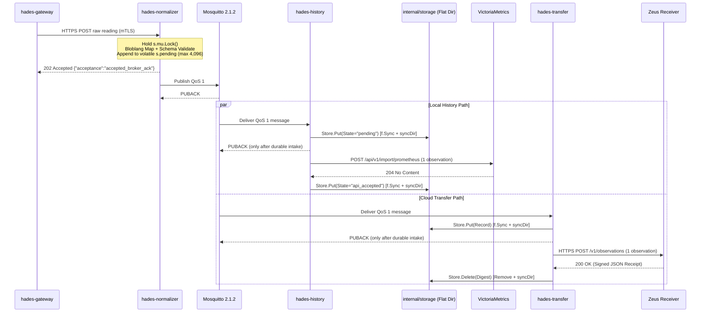
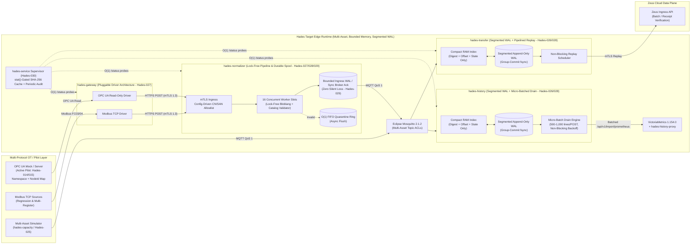
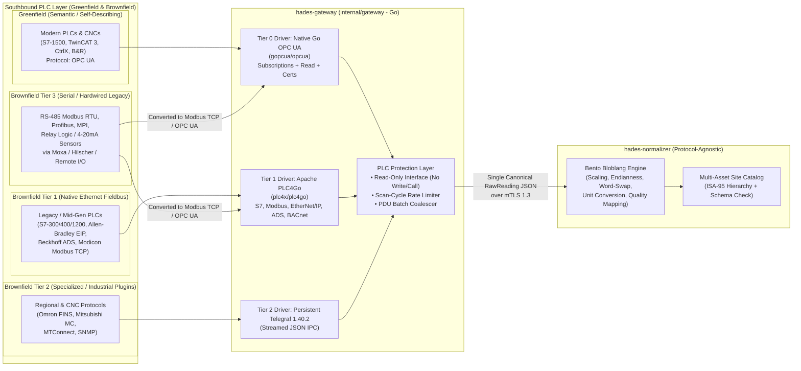
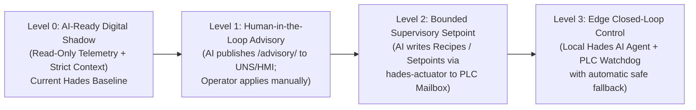
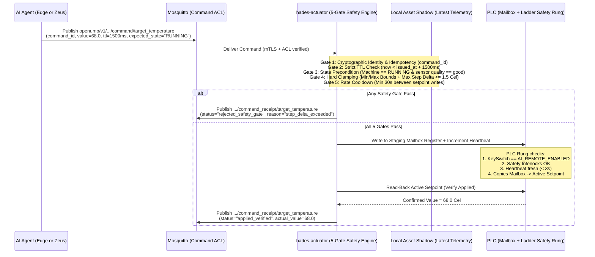
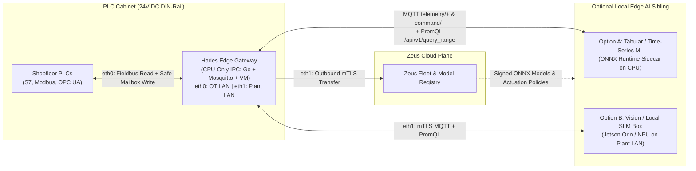
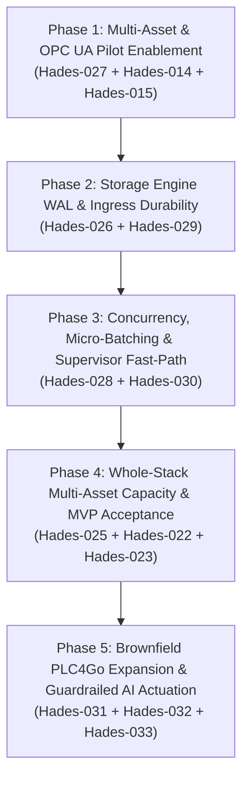

# Hades Architecture Design Specification (ADS): Current As-Built & Target Evolution

* **Document Status:** Living Architecture Specification
* **Date:** 15 October 2026
* **Implementation Repository:** `openump/Hades`
* **Planning & Ticket Repository:** `openump/Hermes` (`Hades-001` through `Hades-033`)
* **Governing ADRs:**
  * [ADR-0001: Project license and third-party dependency policy](file:///Users/let7mu/github/openump/Hades/docs/decisions/0001-license-policy.md)
  * [ADR-0002: Open-source reference components](file:///Users/let7mu/github/openump/Hades/docs/decisions/0002-reference-components.md)
  * [ADR-0003: Go as the language for custom Hades runtime services](file:///Users/let7mu/github/openump/Hades/docs/decisions/0003-runtime-language.md)
  * [ADR-0004: Explicit acceptance boundaries and bounded queues](file:///Users/let7mu/github/openump/Hades/docs/decisions/0004-delivery-durability.md)

---

## 1. Executive Summary & Architectural Principles

**Hades** is the industrial edge data plane of **OpenUMP**. Its mission is to acquire read-only operational technology (OT) signals at a factory site, normalize and validate them against a strict versioned OpenUMP contract, publish contextualized observations to a local MQTT broker, persist local numeric history for site autonomy, and asynchronously forward observations to the **Zeus** cloud control/data plane without allowing cloud outages to disrupt plant-floor visibility.

Every component in Both the **Current Architecture (As-Built)** and the **Target Architecture (To-Be)** adheres to six non-negotiable architectural invariants:
1. **Strictly Read-Only OT Boundary:** Hades never issues write function codes, actuation commands, or PLC program modifications.
2. **Contract-First & Fail-Closed Validation:** Every payload is validated offline against JSON Schema Draft 2020-12 (`urn:openump:schema:1.0:*`). Invalid payloads are never forwarded; they are deterministically quarantined with bounded disk budgets.
3. **Explicit Durability Boundaries:** Network transport acknowledgements (`HTTP 202`, MQTT `PUBACK`, VictoriaMetrics HTTP `204`) are never conflated with verified disk durability or authenticated cloud receipts ([ADR-0004](file:///Users/let7mu/github/openump/Hades/docs/decisions/0004-delivery-durability.md)).
4. **Cloud-Outage Isolation:** A complete or partial disconnect from Zeus must have zero impact on local acquisition, normalization, MQTT fan-out, or local VictoriaMetrics history queries.
5. **Bounded Edge Resource Consumption:** Every memory queue, on-disk spool, quarantine folder, HTTP body, and log sink enforces explicit count and byte ceilings.
6. **Zero-Trust Local Service Identity:** Inter-service communication uses mTLS 1.3 with role-scoped X.509 certificates, explicit MQTT topic ACLs, and read-only query proxies.

---

## 2. Part I — Current Architecture ("As-Built" Baseline)

The current Hades implementation (`Hades-001` through `Hades-025`) delivers a complete, working single-site vertical slice in Go 1.25 alongside pinned open-source infrastructure components (Mosquitto `2.1.2` and VictoriaMetrics `1.154.0`).

### 2.1 Current System Topology



### 2.2 As-Built Component & Binary Inventory

All custom runtime daemons and operational CLIs are implemented in Go ([ADR-0003](file:///Users/let7mu/github/openump/Hades/docs/decisions/0003-runtime-language.md)):

| Binary / Component | Source Path | Current Responsibility & Mechanics |
| :--- | :--- | :--- |
| **`hades-gateway`** | [cmd/hades-gateway/main.go](file:///Users/let7mu/github/openump/Hades/cmd/hades-gateway/main.go), [internal/gateway/gateway.go](file:///Users/let7mu/github/openump/Hades/internal/gateway/gateway.go) | Polls Modbus TCP holding register `0` (`FC03`), decodes `UINT16` `deciCel`, wraps into raw observation JSON, and POSTs over mTLS 1.3 to `hades-normalizer`. |
| **`hades-normalizer`** | [cmd/hades-normalizer/main.go](file:///Users/let7mu/github/openump/Hades/cmd/hades-normalizer/main.go), [internal/normalize/server.go](file:///Users/let7mu/github/openump/Hades/internal/normalize/server.go) | Terminates mTLS ingress, executes embedded Bento Bloblang mapping ([normalize.go](file:///Users/let7mu/github/openump/Hades/internal/normalize/normalize.go)), validates against OpenUMP v1 schemas, quarantines invalid inputs, buffers in memory (`s.pending`), and publishes to MQTT QoS 1. |
| **`hades-history`** | [cmd/hades-history/main.go](file:///Users/let7mu/github/openump/Hades/cmd/hades-history/main.go), [internal/history/history.go](file:///Users/let7mu/github/openump/Hades/internal/history/history.go) | Subscribes to `openump/v1/+/+/+/+/+/telemetry/+`, persists observations to [internal/storage/store.go](file:///Users/let7mu/github/openump/Hades/internal/storage/store.go), converts to Prometheus exposition lines, imports to VictoriaMetrics, and retains deduplication records for 7 days. |
| **`hades-history-proxy`** | [cmd/hades-history-proxy/main.go](file:///Users/let7mu/github/openump/Hades/cmd/hades-history-proxy/main.go), [internal/historyproxy/proxy.go](file:///Users/let7mu/github/openump/Hades/internal/historyproxy/proxy.go) | Enforces mTLS client authentication (`consumer-press-04`) and restricts historian access strictly to read-only `GET`/`HEAD` endpoints (`/api/v1/query`, `/api/v1/query_range`, `/api/v1/export`). |
| **`hades-transfer`** | [cmd/hades-transfer/main.go](file:///Users/let7mu/github/openump/Hades/cmd/hades-transfer/main.go), [internal/transfer/queue.go](file:///Users/let7mu/github/openump/Hades/internal/transfer/queue.go) | Subscribes to telemetry topics using an independent MQTT session, persists observations to a bounded on-disk queue, forwards to Zeus over mTLS, and deletes records only after verifying a cryptographically matched cloud receipt. |
| **`hades-consumer`** | [cmd/hades-consumer/main.go](file:///Users/let7mu/github/openump/Hades/cmd/hades-consumer/main.go) | Reference independent consumer that verifies semantic agreement between live MQTT telemetry and VictoriaMetrics historical queries. |
| **`hades-simulator`** | [cmd/hades-simulator/main.go](file:///Users/let7mu/github/openump/Hades/cmd/hades-simulator/main.go), [internal/sample/sample.go](file:///Users/let7mu/github/openump/Hades/internal/sample/sample.go) | Publishes deterministic, schema-valid simulated telemetry, metadata, and status envelopes over MQTT. |
| **`hades-service`** | [cmd/hades-service/main.go](file:///Users/let7mu/github/openump/Hades/cmd/hades-service/main.go), [internal/supervisor/supervisor.go](file:///Users/let7mu/github/openump/Hades/internal/supervisor/supervisor.go) | Host supervisor wrapper used by [`deploy/systemd/hades-service@.service`](file:///Users/let7mu/github/openump/Hades/deploy/systemd/hades-service@.service). Verifies binary/config SHA-256 digests, manages child process lifecycle, captures bounded logs, and exposes `/status` over `live.sock`. |
| **`hades-site`** | [cmd/hades-site/main.go](file:///Users/let7mu/github/openump/Hades/cmd/hades-site/main.go), [internal/site/deploy.go](file:///Users/let7mu/github/openump/Hades/internal/site/deploy.go) | Performs atomic site configuration validation, rollout, revision checking, rollback, cold backup, and isolated restore ([backup.go](file:///Users/let7mu/github/openump/Hades/internal/site/backup.go)). |
| **`hades-pki`** | [cmd/hades-pki/main.go](file:///Users/let7mu/github/openump/Hades/cmd/hades-pki/main.go) | Generates offline Root CA, server certificates, and role-scoped client certificates (`0600` private keys) for all local services. |
| **`hades-check` / `hades-capacity`** | [cmd/hades-check/main.go](file:///Users/let7mu/github/openump/Hades/cmd/hades-check/main.go), [cmd/hades-capacity/main.go](file:///Users/let7mu/github/openump/Hades/cmd/hades-capacity/main.go) | Offline protocol conformance validator (`hades-check`) and repeatable workload/capacity measurement runner (`hades-capacity`). |

### 2.3 Current Data Contract & Validation Model

* **Schemas:** Compiled offline from [`schemas/v1/common.schema.json`](file:///Users/let7mu/github/openump/Hades/schemas/v1/common.schema.json), [`telemetry.schema.json`](file:///Users/let7mu/github/openump/Hades/schemas/v1/telemetry.schema.json), [`metadata.schema.json`](file:///Users/let7mu/github/openump/Hades/schemas/v1/metadata.schema.json), and [`status.schema.json`](file:///Users/let7mu/github/openump/Hades/schemas/v1/status.schema.json) by [`contracts.Validator`](file:///Users/let7mu/github/openump/Hades/internal/contracts/contracts.go#L34-L90) with network loading explicitly disabled (`offlineLoader`).
* **Wire Constraints:** [`contracts.Decode`](file:///Users/let7mu/github/openump/Hades/internal/contracts/contracts.go#L93-L110) enforces `MaxPayloadBytes = 65,536`, valid UTF-8, no UTF-16 surrogates, maximum JSON nesting depth of `64`, no duplicate object keys, and finite numeric bounds.
* **Topic Grammar:**
  $$\text{openump/v1/}\langle\text{enterprise}\rangle/\langle\text{site}\rangle/\langle\text{area}\rangle/\langle\text{line}\rangle/\langle\text{asset}\rangle/\langle\text{message\_type}\rangle/\langle\text{detail}\rangle$$
  Validated in [`contracts.ParseTopic`](file:///Users/let7mu/github/openump/Hades/internal/contracts/contracts.go) so topic segments must exactly match the JSON envelope's `asset` identity, `message_type`, and `measurement_name` / `status_type`.

### 2.4 Current Durability, Queueing, and Resource Bounds



Current enforced resource bounds across the edge stack:

| Subsystem | Parameter | Current Bound | Code Reference |
| :--- | :--- | :--- | :--- |
| **Normalizer Ingress** | Max concurrent HTTP requests | `16` slots (`64 KiB` body limit) | [internal/normalize/server.go#L17-L43](file:///Users/let7mu/github/openump/Hades/internal/normalize/server.go#L17-L43) |
| **Normalizer Pending Buffer** | Volatile in-memory queue | `4,096` records / `16 MiB` | [internal/normalize/server.go#L18-L19](file:///Users/let7mu/github/openump/Hades/internal/normalize/server.go#L18-L19) |
| **Normalizer Quarantine** | Invalid / overflow disk store | `10,000` files / `64 MiB` (`512 MiB` min free disk) | [internal/normalize/server.go#L20-L56](file:///Users/let7mu/github/openump/Hades/internal/normalize/server.go#L20-L56) |
| **History Intake Store** | Durable queue + 7d dedup ledger | `100,000` files / `256 MiB` (`512 MiB` min free disk) | [internal/history/history.go#L33-L37](file:///Users/let7mu/github/openump/Hades/internal/history/history.go#L33-L37) |
| **Transfer Replay Queue** | Durable cloud outage buffer | `100,000` files / `256 MiB` / `7 days` max age | [internal/transfer/queue.go#L25-L30](file:///Users/let7mu/github/openump/Hades/internal/transfer/queue.go#L25-L30) |
| **Systemd Service Unit** | Process cgroup limits | `CPUQuota=50%`, `MemoryMax=512M`, `TasksMax=64` | [internal/supervisor/supervisor.go#L320-L323](file:///Users/let7mu/github/openump/Hades/internal/supervisor/supervisor.go#L320-L323) |

### 2.5 Honest Assessment of Current Architectural Bottlenecks

As documented in tickets **Hades-026 through Hades-030**, five concrete implementation bottlenecks exist in the current codebase:
1. **Storage Write Amplification & Double RAM Retention (`Hades-026`)**: [`internal/storage/store.go`](file:///Users/let7mu/github/openump/Hades/internal/storage/store.go#L23-L177) stores 1 file per observation (`<sha256>.json`, up to 100,000 files per directory), executes 2 `fsync`s per `Put` (4–5 `fsync`s per observation lifecycle in `hades-history`), and holds the full raw JSON bytes of all records in `Store.Records` in RAM while [`history.Adapter`](file:///Users/let7mu/github/openump/Hades/internal/history/history.go#L50) holds a second unmarshaled copy in RAM—risking OOM against `MemoryMax=512M`.
2. **Single-Asset & Single-Measurement Hardcoding (`Hades-027`)**: [`sample.LoadReadingContext`](file:///Users/let7mu/github/openump/Hades/internal/sample/sample.go#L72-L91) enforces `len(defs) != 1` and `"motor_temperature"`; [`transport.Ingress`](file:///Users/let7mu/github/openump/Hades/internal/transport/tls.go#L81) hardcodes `peer != "gateway-press-04"`; [`gateway.ValidateDriverConfig`](file:///Users/let7mu/github/openump/Hades/internal/gateway/gateway.go#L23-L43) hardcodes `modbus-tcp`, loopback IP, and register `0`.
3. **Coarse Mutex Contention & Unbatched 1-by-1 Drain (`Hades-028`)**: [`normalize.Server.ServeHTTP`](file:///Users/let7mu/github/openump/Hades/internal/normalize/server.go#L97-L168) holds `s.mu.Lock()` across Bloblang execution, validation, `O(N log N)` key sorting, and quarantine disk `fsync`. Both [`history.Drain`](file:///Users/let7mu/github/openump/Hades/internal/history/history.go#L209-L276) and [`transfer.Drain`](file:///Users/let7mu/github/openump/Hades/internal/transfer/queue.go#L165-L250) send 1 HTTP request per observation with blocking 30s inner retry sleeps.
4. **Pre-MQTT Volatile Ingress Window (`Hades-029`)**: [`normalize.Server`](file:///Users/let7mu/github/openump/Hades/internal/normalize/server.go#L156-L168) returns `202 Accepted` (`accepted_volatile`) to `hades-gateway` while holding up to 4,096 observations in volatile RAM before MQTT publication.
5. **Per-Probe Binary SHA-256 Re-Hashing (`Hades-030`)**: [`supervisor.Run`](file:///Users/let7mu/github/openump/Hades/internal/supervisor/supervisor.go#L209-L229) re-reads and SHA-256 hashes the entire service binary (up to 256 MiB) on every `GET /status` poll on `live.sock`.

---

## 3. Part II — Target Architecture ("To-Be" State)

The Target Architecture resolves all five structural bottlenecks (`Hades-026`–`030`), completes the active **OPC UA software pilot integration** (`Hades-014`/`015`), and scales Hades from a single-asset lab prototype to a multi-asset, high-throughput industrial edge runtime without adding external heavy dependencies (no JVM, no Kafka) or violating `MemoryMax=512M`.

### 3.1 Target System Topology



### 3.2 Subsystem Comparison: Current ("As-Built") vs. Target ("To-Be")

| Architectural Dimension | Current Architecture (As-Built) | Target Architecture (To-Be) | Governing Ticket(s) |
| :--- | :--- | :--- | :--- |
| **OT Protocol Support** | Hardcoded `modbus-tcp` (loopback IP, holding register `0`, `UINT16`) and `simulator` | Pluggable `Driver` interface supporting **OPC UA** (active software pilot with NodeId/namespace map) and multi-register **Modbus TCP** | `Hades-014`, `Hades-015`, `Hades-027` |
| **Asset & Measurement Catalog** | Single asset (`press-04`) and single measurement (`motor_temperature` in `Cel`/`K`) enforced by `len(defs) != 1` | Multi-asset, multi-measurement catalog registry keyed by `(enterprise, site, area, line, asset)` and `measurement_name` | `Hades-025`, `Hades-027` |
| **mTLS Ingress Authorization** | Hardcoded `peer != "gateway-press-04"` in `internal/transport/tls.go` | Config-driven X.509 CommonName / SAN allowlist mapped to authorized asset scopes | `Hades-027` |
| **Edge Storage Engine (`internal/storage`)** | Flat directory with up to `100,000` `<sha256>.json` files; 2 `fsync`s per `Put` (4–5 `fsync`s/observation in history) | Segmented append-only Write-Ahead Log (WAL) with group-commit `fsync` and lightweight state records (`pending` → `api_accepted`) | `Hades-026` |
| **Memory Footprint Under Backlog** | Full JSON payloads duplicated in `Store.Records` + `history.Adapter.records` (~2x `256 MiB` in heap) | Compact in-memory index (`~64–96 bytes/record` = `<10 MiB` for 100k records); payloads streamed from WAL segments only on drain/export | `Hades-026` |
| **Normalizer Concurrency** | Single `s.mu.Lock()` held across HTTP read, Bloblang mapping, schema validation, `O(N log N)` key sort, and disk `fsync` | Lock-free worker pool (16 concurrent Bloblang + schema validators); `O(1)` ring index for quarantine eviction; `/health` never blocked by I/O | `Hades-028` |
| **Normalizer Ingress Durability** | Returns `202 accepted_broker_ack` after appending to volatile slice (`s.pending`); loses up to 4,096 items on restart if broker is down | Returns `2xx` only after bounded local WAL append (`accepted_durable`) or synchronous MQTT QoS 1 `PUBACK` (`accepted_broker_ack`), returning `503` on broker outage so gateway retries | `Hades-029` |
| **Historian & Transfer Egress Drain** | 1 HTTP POST per single observation; inner retry loop sleeps up to 30s holding up the drain loop (Head-of-Line blocking) | Micro-batched HTTP POST (`500–1,000` Prometheus lines per request) and non-blocking per-batch retry backoff scheduler | `Hades-028` |
| **Supervisor `/status` Integrity Check** | Synchronous full-binary SHA-256 read (`up to 256 MiB`) on every HTTP request to `live.sock` | Startup full SHA-256 verification cached with `os.Stat` (`dev`, `ino`, `size`, `mtime`, `ctime`, `uid`, `mode`); re-hashes only on metadata change or periodic background audit | `Hades-030` |

---

### 3.3 Deep-Dive Specification of Target Subsystems

#### 3.3.1 Target Storage Engine: Segmented Append-Only WAL & Compact Index (`Hades-026`)
To support 100,000 queued records within a strict `512 MiB` systemd `MemoryMax` budget and protect industrial flash storage from `fsync` wear:
* **On-Disk Layout:** Replace `<dir>/<sha256>.json` with numbered append-only segment files (`segment-000001.wal`, `16 MiB` max per segment, up to `16` active segments = `256 MiB`).
* **Framing Format:** Each WAL entry uses a deterministic binary header:
  $$\underbrace{\text{CRC32C}}_{\text{4 B}} \;\|\; \underbrace{\text{EntryType}}_{\text{1 B (DATA | STATE | DELETE)}} \;\|\; \underbrace{\text{TimestampNs}}_{\text{8 B}} \;\|\; \underbrace{\text{Digest (SHA-256)}}_{\text{32 B}} \;\|\; \underbrace{\text{PayloadLen}}_{\text{4 B}} \;\|\; \underbrace{\text{Payload}}_{\text{0..64 KiB}}$$
* **Single-Payload Write for State Transitions:**
  * On `Intake`: Append a `DATA` frame (`Payload` included).
  * On VictoriaMetrics `204` acceptance: Append a `45-byte` `STATE` frame (`EntryType = STATE_ACCEPTED`, `PayloadLen = 0`) instead of rewriting the entire JSON file.
  * Group-commit flushes and `fsync`s the active segment once per batch or configurable flush window (e.g., `5–10 ms`), reducing `fsync` IOPS by $>90\%$ under burst load.
* **In-Memory Index:**
  ```go
  type IndexEntry struct {
      SegmentID uint32
      Offset    uint32
      Length    uint32
      TimeNs    int64
      State     RecordState // Pending, APIAccepted, Deleted
  }
  ```
  At `100,000` records, `map[[32]byte]IndexEntry` consumes `< 12 MiB` of Go heap (down from `~512 MiB` of duplicated raw JSON slices).

#### 3.3.2 Multi-Asset Catalog Registry, Dynamic mTLS Authz, & Pluggable Drivers (`Hades-014`, `Hades-015`, `Hades-027`)
* **Multi-Asset Catalog (`internal/sample` & `internal/site`):**
  * Replace the single-asset `ReadingContext` with a site-level `Catalog` mapping `AssetKey{Enterprise, Site, Area, Line, Asset}` $\rightarrow$ `AssetSpec{Protocol, SourceID, ClockState, Measurements map[string]MeasurementDef}`.
  * `hades-normalizer`, `hades-history`, and `hades-transfer` look up the incoming observation's `AssetKey` and `measurement_name` in $O(1)$ time, rejecting any uncataloged asset or measurement with a `context` quarantine error.
* **Config-Driven mTLS Identity Binding (`internal/transport/tls.go`):**
  * Replace hardcoded `peer != "gateway-press-04"` with an injected `PeerAuthorizer` configured from the reviewed site manifest (e.g., mapping client certificate CommonName `gateway-line-1` or `gateway-press-04` to permitted asset prefixes).
* **Pluggable Gateway Driver Interface (`internal/gateway`):**
  ```go
  type Driver interface {
      Poll(ctx context.Context) ([]RawReading, error)
      Close() error
  }
  ```
  * **`opc-ua` Driver (`Hades-014`/`015`):** Connects read-only to the pinned OPC UA mock server endpoint, reads configured `namespace` + `NodeId` signals, captures source/server timestamps and quality codes, and emits `RawReading` structs.
  * **`modbus-tcp` Driver:** Retains full backward compatibility with the existing register map and conformance fixtures.

#### 3.3.3 Concurrent Normalizer Pipeline & Micro-Batched Egress (`Hades-028`, `Hades-029`)
* **Normalizer Lock Splitting (`internal/normalize/server.go`):**
  * Request body reading, JSON decoding, Bloblang mapping (using a per-worker slot or concurrent-safe compiled Bloblang executor), and JSON Schema validation run **outside** `s.mu`.
  * Quarantine eviction uses an in-memory doubly-linked list / ring buffer of `(timestamp, digest)` instead of calling `sort.Strings(keys)` over 10,000 map keys under a global lock.
* **Closing the Pre-MQTT Volatility Window (`Hades-029`):**
  * `hades-normalizer` either persists accepted envelopes into a bounded `16 MiB` WAL spool before returning `202 Accepted` (`accepted_durable`) or awaits the local Mosquitto QoS 1 `PUBACK` within the request deadline before returning `200 OK` (`accepted_broker_ack`). If Mosquitto is unreachable and the local normalizer spool is full, `hades-normalizer` returns `503 Service Unavailable` so `hades-gateway` retains and retries the reading.
* **Micro-Batched Historian & Transfer Drain (`internal/history/history.go`, `internal/transfer/queue.go`):**
  * `history.Adapter.Drain` collects up to `MaxBatchRecords` (e.g., `500` records or `256 KiB` of Prometheus exposition lines) from the WAL, sends a single HTTP `POST` to `/api/v1/import/prometheus`, and appends a single batch of `STATE_ACCEPTED` markers to the WAL.
  * Retry backoff state (`attempt`, `nextRetryAt`) is stored on the adapter/queue struct rather than sleeping inside an infinite loop, returning immediately when `now < nextRetryAt` so health reporting and intake never stall.

#### 3.3.4 Metadata-Gated Supervisor Integrity Verification (`Hades-030`)
* **Startup Verification & Stat Caching (`internal/supervisor/supervisor.go`):**
  * When `hades-service` starts, it performs a full cryptographic SHA-256 read of `BinaryPath` and all `ConfigFiles`, storing a `verifiedStat` record (`dev`, `ino`, `size`, `mtimeNs`, `ctimeNs`, `mode`, `uid`) for each path.
  * When `GET /status` is called on `live.sock`, the handler executes `os.Lstat(path)` ($\sim 1\;\mu\text{s}$ syscall) and checks ownership, permissions, and `verifiedStat` equality. Full `hashFile` re-reads occur only if metadata changed or when a background integrity ticker (`60s`) fires.

---

## 4. Part III — Universal PLC Connectivity Strategy (Greenfield & Brownfield)

To support the broadest possible range of industrial controllers without bloating the Hades runtime or coupling downstream services to PLC quirks, Hades separates **Southbound Protocol Acquisition** (`hades-gateway`) from **Northbound Semantic Normalization** (`hades-normalizer` Bloblang + OpenUMP site catalog).



### 4.1 Greenfield Strategy (Modern Smart Equipment)
* **Target Hardware:** Siemens S7-1500 / S7-1200 (FW $\ge$ 4.4), Beckhoff TwinCAT 3, Rockwell ControlLogix 5580, B&R, Bosch Rexroth ctrlX, modern EuroMap/OPC UA injection molding and CNC centers.
* **Primary Driver (Tier 0):** **Native Go OPC UA (`gopcua/opcua`)** inside `hades-gateway` (aligned with the active software pilot in [docs/pilot/site-profile.md](file:///Users/let7mu/github/openump/Hades/docs/pilot/site-profile.md)).
* **Architectural Benefits:**
  * Resolves symbolic `NamespaceURI + NodeId` mappings rather than fragile raw memory offsets.
  * Preserves PLC-originated `SourceTimestamp`, `ServerTimestamp`, and `StatusCode` (`Good`, `Uncertain`, `Bad`), mapping directly to `clock_state: "synchronized"`.
  * Supports report-by-exception (`MonitoredItems`) and mutual X.509 application certificate authentication (`Basic256Sha256`).

### 4.2 Brownfield Strategy (Legacy PLCs, Locked Firmware, & Serial Fieldbus)
In brownfield plants where PLC programs cannot be modified and lines cannot be stopped, Hades uses three concentric connectivity tiers:
1. **Tier 1 — Direct In-Process Ethernet Fieldbus via Apache `PLC4Go` (`github.com/apache/plc4x/plc4go`):**
   * Pure-Go implementation of Apache PLC4X (Apache-2.0, zero JVM overhead) behind `gateway.Driver`.
   * Covers legacy Ethernet PLCs out of the box: **Siemens S7 (`s7comm` DB/M/I/Q reads for S7-300/400/1200)**, **Allen-Bradley EtherNet/IP (`CIP`)**, **Beckhoff ADS**, **Modbus TCP/RTU**, **BACnet/IP**, and **KNXnet/IP**.
2. **Tier 2 — Persistent Supervised Telegraf `1.40.2` Sidecar ([ADR-0002](file:///Users/let7mu/github/openump/Hades/docs/decisions/0002-reference-components.md)):**
   * Replaces the current per-poll `telegraf --once` process spawn ([internal/gateway/driver.go#L65](file:///Users/let7mu/github/openump/Hades/internal/gateway/driver.go#L65)) with a persistent streaming subprocess for specialized regional/CNC protocols (**Mitsubishi MELSEC MC**, **Omron FINS**, **MTConnect**, **SNMP**).
3. **Tier 3 — Hardware Protocol Isolation at the Cabinet Boundary (Deep Legacy Serial / 4–20mA):**
   * For pre-Ethernet PLCs (**Profibus**, **MPI**, **RS-485 Modbus RTU**, **DH+**) or pure electromechanical panels (**4–20mA / 24V discrete I/O**), use DIN-rail industrial protocol gateways (e.g., Moxa MGate, Hilscher netTAP, or WAGO/Advantech remote I/O islands) to expose isolated **Modbus TCP** or **OPC UA** to `hades-gateway`.

### 4.3 Four Mandatory PLC Protection Guardrails
1. **Compile-Time Read-Only Interface:** `gateway.Driver` exposes only `Poll(ctx) ([]RawReading, error)`. Neither `plc4go` `WriteRequestBuilder()` nor OPC UA `Write()`/`Call()` is wired in `hades-gateway`.
2. **PLC Scan-Cycle Protection:** Enforces per-PLC `min_poll_interval`, `max_concurrent_requests = 1`, contiguous register coalescing, and exponential circuit-breaker backoff so polling never starves a legacy PLC's communications processor.
3. **Honest Clock & Quality Provenance:** Brownfield register protocols without PLC timestamps record `adapter_timestamp` on receipt and declare `clock_state` honestly from the site catalog.
4. **Declarative Byte/Word Manipulation in Bloblang:** Endianness swaps (`CDAB` 32-bit floats), bit-masking, and linear scaling (`y = mx + b`) execute declaratively in `hades-normalizer` Bloblang scripts rather than hardcoded Go driver logic.

---

## 5. Part IV — AI-Ready & Safe Shopfloor Actuation Strategy (`hades-actuator`)

### 5.1 Why the Core Telemetry Data Plane (`hades-gateway` / `hades-normalizer`) Is Strictly Read-Only
Hades enforces a strict **Read-Only** boundary on its core telemetry plane ([WHITEPAPER.md §2.3](file:///Users/let7mu/github/openump/Hades/WHITEPAPER.md#L63), [read-only-checklist.md](file:///Users/let7mu/github/openump/Hades/docs/pilot/read-only-checklist.md#L14-L15)) for five foundational reasons:
1. **Physical & Functional Safety (IEC 61508 / ISO 13849):** Writing an unvalidated register or coil can cause mechanical damage or operator injury; real-time safety interlocks belong in deterministic Level 1 PLC hardware (`1–10 ms` scan cycle), not a garbage-collected Linux/MQTT pipeline.
2. **Zero-Disruption Brownfield Approval:** Plant Managers and Controls Engineers can approve a provably read-only observer in days without recertifying machine safety or risking unscheduled line stops.
3. **IEC 62443 Blast-Radius Containment:** An outbound-only, read-only telemetry plane prevents cloud or edge compromises from becoming remote actuation vectors.
4. **Incompatible Replay Semantics:** Telemetry *must* be buffered and replayed after a 4-hour outage ([ADR-0004](file:///Users/let7mu/github/openump/Hades/docs/decisions/0004-delivery-durability.md)); replaying a 4-hour-old machine actuation command after an outage is physically dangerous.
5. **PLC Scan-Cycle Integrity:** Direct asynchronous writes to internal PLC working memory cause race conditions unless mediated by a dedicated PLC mailbox buffer.

### 5.2 Separating the Read Data Plane from the AI Write Control Plane

To make Hades **AI-Ready** for closed-loop optimization without violating the five principles above, **actuation is never mixed into the telemetry replay queues**. Instead, shopfloor writes are handled by an isolated, opt-in control plane (**`hades-actuator`**) governed by opposite architectural laws:

| Architectural Property | Telemetry Plane (Read Path) | AI Actuation Plane (Write Path — `hades-actuator`) |
| :--- | :--- | :--- |
| **Outage / Disconnect Behavior** | **Store-and-Forward** (`100,000` records, 7-day replay). | **Fail-Safe Drop.** Never queue stale commands; abort immediately if `now > issued_at + ttl_ms`. |
| **PLC Memory Target** | Any approved sensor/status register or `NodeId`. | Dedicated **PLC Staging Mailbox + Watchdog** registers only—never raw physical outputs (`Q0.0`). |
| **Edge Validation** | JSON Schema + Unit + Catalog check (`hades-normalizer`). | **5-Gate Deterministic Safety Engine** (Identity, TTL, State Precondition, Envelope/Slew-Rate Clamping, Cooldown). |
| **Feedback Loop** | Asynchronous historian & cloud receipt. | Synchronous **Read-After-Write** verification + signed `command_receipt` back to AI agent. |

### 5.3 The 4-Level Progressive AI Autonomy Model

Sites adopt AI capabilities incrementally per asset via explicit configuration in the reviewed site manifest:



* **Level 0 (AI-Ready Digital Shadow):** Standardized units, explicit quality (`good`/`uncertain`/`bad`), clock synchronization state, and ISA-95 asset hierarchy eliminate training/inference data ambiguity.
* **Level 1 (Operator Advisory / Zero PLC Write):** AI agents publish recommendations (`openump/v1/{enterprise}/{site}/{area}/{line}/{asset}/advisory/{parameter}`) to local HMIs. Operators review and apply changes manually.
* **Level 2 (Supervisory Setpoint Optimization):** AI adjusts bounded process setpoints (e.g., target temperature, line speed reference) through `hades-actuator` into the PLC staging mailbox.
* **Level 3 (Edge-Local Closed-Loop Control):** Low-latency AI inference runs locally on the Hades edge host (independent of Zeus cloud availability) with continuous PLC heartbeat monitoring.

### 5.4 The 5-Gate Deterministic Safety Engine & PLC Mailbox Handshake



Every writable setpoint in the site catalog is governed by a deterministic safety envelope that AI models cannot bypass:
1. **Gate 1 — Identity & Non-Repudiation:** Requires a dedicated mTLS certificate (`ai-governor` / `actuator`) and unique `command_id`.
2. **Gate 2 — Strict Expiration (`max_ttl_ms`):** Commands older than their TTL (e.g., `2,000 ms`) are discarded immediately to prevent delayed actuation.
3. **Gate 3 — Optimistic Concurrency (`based_on_observation_id` & `required_machine_state`):** Verifies against the latest local telemetry shadow that the machine is still in the expected state and sensor quality is `good`.
4. **Gate 4 — Hard Envelope & Slew-Rate Clamping (`min_value`, `max_value`, `max_step_delta`):** Rejects out-of-range values and limits per-step changes to prevent thermal or mechanical shock.
5. **Gate 5 — PLC Mailbox + Watchdog Fallback:** `hades-actuator` writes only to staging registers (`AI_Proposed_Setpoint`, `AI_Heartbeat_Tick`). If the edge host disconnects or the operator switches the physical cabinet selector to `MANUAL`, the PLC watchdog expires and immediately reverts to safe local defaults.

---

## 6. Part V — Edge Hardware & Physical Deployment Architecture

### 6.1 Pure-CPU Footprint Philosophy (No GPU/NPU Required for Hades)

Because Hades is implemented in compiled native **Go** and **C/C++** (`Mosquitto`) with zero Python runtime or machine-learning framework dependencies ([ADR-0002](file:///Users/let7mu/github/openump/Hades/docs/decisions/0002-reference-components.md), [ADR-0003](file:///Users/let7mu/github/openump/Hades/docs/decisions/0003-runtime-language.md)), **Hades does not require AI accelerator hardware (GPUs, NPUs, or TPUs).**

With the segmented WAL storage engine ([Hades-026](file:///Users/let7mu/github/openump/Hermes/plans/hades/tickets/Hades-026.md)), the complete Hades runtime stack exhibits a lightweight, deterministic footprint on standard `linux/amd64` and `linux/arm64` CPUs:
* **Resident Memory (RSS):** `~250 MB – 600 MB` total (`~15–25 MB` per Go service, `~20 MB` for `Mosquitto`, and `~150–350 MB` for `VictoriaMetrics` depending on active time-series cardinality).
* **CPU Utilization:** `0.3 – 1.5` physical cores for `100 – 2,000` observations/second.
* **Binary & Schema Disk Footprint:** `< 180 MB` across all pinned binaries and JSON Schemas.

Consequently, edge hardware selection for Hades is governed not by compute or GPU FLOPS, but by **flash write endurance (`fsync`), physical OT/IT network segmentation, and industrial cabinet survivability.**

### 6.2 Reference Industrial Hardware Sizing Tiers

| Hardware Tier | Target Shopfloor Scope | CPU & Architecture | Memory (RAM) | Storage (Critical for WAL & TSDB) | Representative Industrial Hardware |
| :--- | :--- | :--- | :---: | :--- | :--- |
| **Tier 1: Cell / Single-Machine Gateway** | **1 – 5 PLCs**<br>Up to `200 tags/s`<br>7–14 days local history | **ARM64** (4-core Cortex-A72/A76) or **x86_64** (Intel N97 / N100 / Atom x6211E) | **2 – 4 GB** | **64 – 128 GB** M.2 NVMe or Industrial SSD *(No consumer microSD)* | • Seeed reComputer Industrial R1000 / R1100<br>• Kunbus Revolution Pi Connect 4<br>• OnLogic Factor 201 / CL210G |
| **Tier 2: Production Line Gateway (Standard)** | **5 – 30 PLCs**<br>`500 – 5,000 tags/s`<br>30–90 days history + 7-day cloud-outage WAL | **x86_64** 4-core (Intel Atom x6413E / Celeron J6412 / Core i3-N305) | **4 – 8 GB** | **256 GB** Industrial M.2 NVMe / SATA SSD with Power-Loss Protection (PLP) | • Advantech UNO-238 / UNO-137<br>• Siemens SIMATIC IPC227G / IPC127E<br>• Beckhoff C6015 / C6017<br>• Moxa V2406C / UC-8200 |
| **Tier 3: Plant Area Aggregator / VM** | **30 – 100+ PLCs**<br>`10,000+ tags/s`<br>6–12 months history | **x86_64** 4–8 vCPU (Industrial Core i5 / Xeon-D or VM on plant ESXi / Proxmox) | **8 – 16 GB** | **512 GB – 1 TB** Enterprise NVMe / RAID-1 SSD | • Advantech UNO-348<br>• OnLogic Helix 500<br>• Plant-floor Virtual Machine |

### 6.3 Five Non-Negotiable Physical Cabinet Specifications

1. **Industrial SSD / NVMe with Power-Loss Protection (Strict Ban on Consumer microSD):**
   * Hades enforces `fsync` durability across its ingress/egress WAL queues ([Hades-017](file:///Users/let7mu/github/openump/Hermes/plans/hades/tickets/Hades-017.md), [Hades-026](file:///Users/let7mu/github/openump/Hermes/plans/hades/tickets/Hades-026.md), [Hades-029](file:///Users/let7mu/github/openump/Hermes/plans/hades/tickets/Hades-029.md)) and continuous block merges in `VictoriaMetrics`. Consumer SD cards suffer controller wear-out and silent corruption within months under continuous `fsync` workloads. `/var/lib/hades` must reside on an industrial M.2 NVMe or SATA SSD (or pSLC industrial eMMC for compact Tier 1 gateways).
2. **Dual-Homed Independent Gigabit Ethernet NICs (`2× 1GbE` Minimum):**
   * **`eth0` (Southbound OT NIC):** Bound to the isolated PLC cabinet subnet (`192.168.x.x` / VLAN) with **no default gateway**, used exclusively by `hades-gateway` and `hades-actuator`.
   * **`eth1` (Northbound IT/WAN NIC):** Connected to the plant IT network for outbound mTLS transfer (`hades-transfer` → **Zeus**) and authenticated local PromQL/MQTT consumers.
3. **Fanless Sealed Enclosure & `24V DC` DIN-Rail Power:**
   * Active cooling fans ingest conductive metal dust and oil mist on the shopfloor. Gateways mounted inside PLC cabinets must use fanless aluminum heatsink enclosures rated for `-20°C to +60°C` and powered directly from the cabinet's `24V DC` rail (`12–36V DC` wide-range terminal block).
4. **Integrated Isolated RS-232/422/485 Serial Ports (Brownfield Readiness):**
   * Built-in isolated serial ports allow `hades-gateway` (`PLC4Go` Modbus RTU / serial drivers in [Hades-031](file:///Users/let7mu/github/openump/Hermes/plans/hades/tickets/Hades-031.md)) to poll legacy serial meters, drives, and PLCs directly without external protocol converters.
5. **Battery-Backed Real-Time Clock (RTC) & Hardware TPM 2.0:**
   * A coin-cell RTC maintains monotonic wall-clock accuracy across site power outages before enterprise NTP recovers, preventing false timestamp-freshness quarantines in `internal/contract`. TPM 2.0 secures the host's mTLS private keys against physical extraction.

### 6.4 Decoupled Local Edge AI Companion Topology (Sibling Node Pattern)

To keep Hades deterministic, small, and auditable, **AI/ML inference runtimes are never embedded inside the Hades repository or processes.** Instead, when a site requires low-latency local intelligence, a **Local Edge AI Companion** is deployed *next to* Hades over the existing OpenUMP MQTT and PromQL contracts:



* **Topology A — Cloud / Plant-Server AI (Zero Edge AI Hardware):** 100% of AI training, LLM copilot workflows, and cross-line optimization execute in **Zeus** and send signed commands to `hades-actuator`. The edge requires only a Tier 1/Tier 2 CPU IPC.
* **Topology B — Local Time-Series / MPC Edge AI (Same CPU IPC, Sibling Container):** Lightweight tabular/time-series models (`ONNX Runtime`, Isolation Forest, PID/MPC tuning) run in an isolated sibling container on the same Tier 2 CPU IPC (`< 200 MB RAM`, `< 5 ms` inference latency), subscribing to Hades MQTT and querying local `VictoriaMetrics` with zero GPU hardware.
* **Topology C — Heavy Local Vision / Acoustic / Air-Gapped LLM (Dedicated NPU/GPU Sibling Box):** Only lines requiring high-frame-rate camera inspection or air-gapped local LLMs deploy an NPU/GPU box (e.g., NVIDIA Jetson Orin or Intel Core Ultra NPU) on `eth1`. It consumes Hades telemetry and submits proposals to `hades-actuator` as an untrusted external client—ensuring an AI OOM or GPU hang never affects Hades telemetry collection or PLC safety interlocks.

---

## 7. Part VI — Phased Migration & Verification Roadmap

To preserve continuous CI green status and adherence to `openump-development` slice discipline, the transition from Current to Target Architecture is sequenced into five verifiable phases:



1. **Phase 1 — Multi-Asset Catalog & Active OPC UA Pilot (`Hades-027`, `Hades-014`, `Hades-015`):**
   * Generalize `sample.ReadingContext` to a multi-asset catalog, replace the hardcoded `gateway-press-04` mTLS check with config-driven authorization, and implement the read-only OPC UA driver in `internal/gateway` alongside Modbus TCP.
2. **Phase 2 — Storage Engine WAL & Normalizer Ingress Durability (`Hades-026`, `Hades-029`):**
   * Replace the flat `<sha256>.json` store and duplicated in-memory payload maps with the segmented append-only WAL + compact index, and close the pre-MQTT normalizer volatility gap.
3. **Phase 3 — High-Throughput Normalizer & Micro-Batched Drain (`Hades-028`, `Hades-030`):**
   * Move Bloblang mapping and schema validation outside `s.mu`, add micro-batched Prometheus import and non-blocking retry scheduling to `history`/`transfer`, and add `stat`-gated digest caching to `internal/supervisor`.
4. **Phase 4 — Whole-Stack Multi-Asset Capacity Qualification & MVP Sign-Off (`Hades-025`, `Hades-022`, `Hades-023`):**
   * Run the multi-asset whole-stack capacity harness (`cmd/hades-capacity`) across steady, burst, and cloud-outage scenarios on the reference host, feed measured WAL disk growth and RSS into the retention worksheet, and complete the MVP evaluation package.
5. **Phase 5 — Brownfield `PLC4Go` Expansion & Guardrailed AI Actuation (`Hades-031`, `Hades-032`, `Hades-033`):**
   * Add the multi-tier universal PLC connectivity drivers (`gopcua`, `PLC4Go` for Siemens S7/Modbus/EtherNet-IP/ADS/BACnet, and persistent supervised Telegraf) with PLC scan-cycle protection guardrails (`Hades-031`), define the OpenUMP `command` / `command-receipt` / `actuation-policy` schemas and ACL boundaries (`Hades-032`), and deliver the isolated 5-Gate `hades-actuator` service with PLC staging mailbox and watchdog verification (`Hades-033`).


## Hades-029 ingress boundary update

The historical pre-MQTT volatile ingress gap described above is closed by the broker-ack option: HTTP 202 now follows successful QoS 1 PUBACK, and failures return 503 while the gateway retains the original reading. No local durable ingress spool is claimed. See [current guarantee](operations/ingress-acknowledgement.md).
